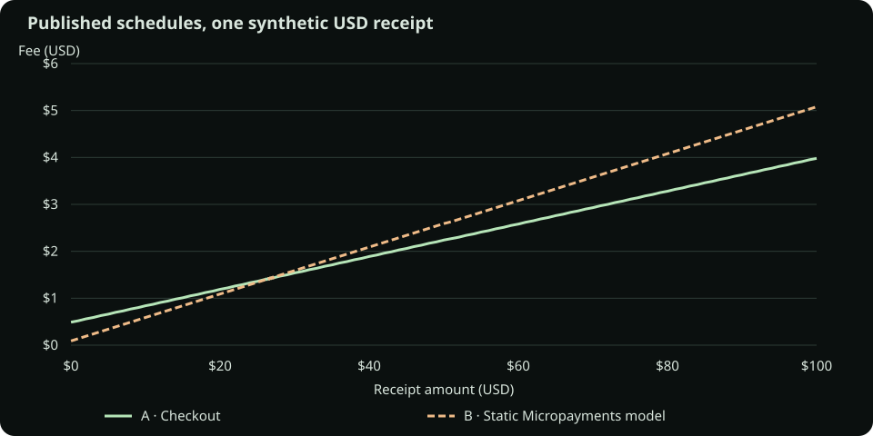

# PayPal US domestic USD: two published plans

[Open the case study](https://andylamyinwik.github.io/termshift-finance-lab/case-studies/paypal-usd/) · [Downloadable case report](../../public/case-studies/paypal-usd/case-study.md) · [Source record](../../src/case-studies/paypal-usd/source-capture.json)

This compares **A: PayPal Checkout** with **B: a Static Micropayments rate model** on invented incoming merchant payments. It is a comparison of two published schedules, not a reconstruction of a historical fee increase. A complete PayPal contract, actual account charges and eligibility are outside the model.

## Source and applicability

The [PayPal US merchant fee page](https://www.paypal.com/us/business/paypal-business-fees) was checked on **2026-10-27, Asia/Shanghai**. It displayed a last-updated date of **2026-10-01**. The accompanying [US User Agreement, Micropayments section](https://www.paypal.com/us/legalhub/paypal/useragreement-full#micropayments) was checked on the same date. A small structured record preserves the observations and assumptions; it is not an archive of the complete web pages or authenticated proof of their history.

Scope is eligible US domestic commercial payments received in USD. Domestic refers to sender and receiver belonging to the same market under PayPal's definition. Micropayments requires approval, and not every payment type qualifies. **B assumes a previously approved Static account.** Dynamic Micropayments instead chooses the lower applicable tariff for each eligible transaction. PayPal may convert Static accounts to Dynamic and need not offer Static as an alternative. This case establishes no visitor's eligibility or ability to obtain Static pricing.

Excluded: cross-border charges, currency conversion, refunds, reversals, disputes, chargebacks, negotiated or account-specific prices, taxes, ancillary charges and other payment products. No PayPal API or bank account is accessed.

## Source-to-model mapping

| Source field / section | Plan A | Plan B | TermShift field |
| --- | ---: | ---: | --- |
| Domestic Checkout / domestic Micropayments percentage | 3.49% | 4.99% | `rules.transactionFee.rateBps`: `349` / `499` |
| Commercial USD / Micropayments USD fixed fee | USD 0.49 | USD 0.09 | `rules.transactionFee.fixedCents`: `49` / `9` |
| Received currency | USD | USD | `currency: "USD"` |
| Model observation date | 2026-10-27 | 2026-10-27 | descriptive `effectiveDate` |

1 basis point is 0.01%. Contract version `1.0.0`, `effectiveDate`, the October billing month and synthetic transaction dates identify a reproducible fixture, not provider release dates or real account events. The existing `purchase` transaction shape represents an incoming receipt for this case. Only transaction fees are enabled; no monthly or late fees are invented.

The existing schema uses `oldContract` and `newContract` internally. These map to **A** and **B**, respectively; `deltaCents` is **B minus A**. The page and human reports use A/B names to avoid implying a timeline. Proof Schema v1 and the financial algorithms remain unchanged.

## Independent calculation

For a receipt of `c` integer cents, the model calculates:

```text
A = round_half_up(c × 349 / 10000) + 49 cents
B = round_half_up(c × 499 / 10000) +  9 cents
```

Rounding is performed separately for each receipt before its fixed fee is added. **This is TermShift's policy, not a confirmed PayPal rounding policy.** The consulted sources do not establish that PayPal performs the same rounding. Results should be described as modeled fees based on published rates.

The expected values below are manually tabulated cents. A separate test-only calculator parses decimal percentage and dollar strings into rational integers, then rounds by quotient/remainder. It imports no engine money helpers. Tests compare the independent calculator, the fixed expectations and the formal engine, and exhaustively compare every single-receipt amount from USD 0.01 through USD 100.00.

| Synthetic receipts | Expected A | Engine A | Expected B | Engine B | B − A |
| --- | ---: | ---: | ---: | ---: | ---: |
| 1 × USD 1.00 | $0.52 | $0.52 | $0.14 | $0.14 | −$0.38 |
| 1 × USD 5.00 | $0.66 | $0.66 | $0.34 | $0.34 | −$0.32 |
| 1 × USD 10.00 | $0.84 | $0.84 | $0.59 | $0.59 | −$0.25 |
| 1 × USD 20.00 | $1.19 | $1.19 | $1.09 | $1.09 | −$0.10 |
| 1 × USD 26.66 | $1.42 | $1.42 | $1.42 | $1.42 | $0.00 |
| 1 × USD 26.67 | $1.42 | $1.42 | $1.42 | $1.42 | $0.00 |
| 1 × USD 30.00 | $1.54 | $1.54 | $1.59 | $1.59 | +$0.05 |
| 1 × USD 100.00 | $3.98 | $3.98 | $5.08 | $5.08 | +$1.10 |
| 10 × USD 1.00 | $5.20 | $5.20 | $1.40 | $1.40 | −$3.80 |
| USD 1 + 10 + 30 + 100 | $6.88 | $6.88 | $7.40 | $7.40 | +$0.52 |



The curve connects sampled official-engine results; it is a visual aid, not a continuous billing formula. Exact selected fees appear in the table. Samples include cent-by-cent detail around the crossover.

## Why the difference changes

B has a 40-cent lower fixed fee but a 150-basis-point higher proportional fee. Ignoring rounding, `B − A = 0.015 × receipt_USD − 0.40 USD`, with an intersection at USD 26⅔. Cent rounding means **USD 26.67 is not a unique rounded switch point**: both USD 26.66 and USD 26.67 tie at USD 1.42.

An exhaustive scan of the modeled USD 0.01–100.00 cent grid finds the first `B > A` at USD 26.76 and the last `B < A` at USD 26.55. There are 65 equal-fee amounts, spanning USD 26.16–27.15 but **not forming one continuous interval**. The independent reference and official engine agree on this pattern. These findings apply to this model and finite domain, not all PayPal pricing behavior.

Transaction count matters as well as gross value: ten USD 1 receipts incur ten fixed fees, so they do not equal one USD 10 receipt. In a heterogeneous basket, opposite signs can offset; fees must still be calculated and rounded per transaction before summing.

## Portable evidence and reproduction

Each of the eight nonzero scenarios has a complete `*-proof.json` and an A/B-labeled `*-report.md` in [the public evidence directory](../../public/case-studies/paypal-usd/). A real one-comparison `searchCounterexamples` call supplies the original base witness, followed by `createImpactProof`, `verifyImpactProof` and the official Markdown formatter. Human labels are adapted, without changing financial evidence or Proof Schema v1.

Purchase counts are pinned to the original scenario and amount ranges span the original amounts. Uniform scenarios have no permitted reduction. The mixed basket may shrink within its stated budget while retaining a nonzero delta and its direction; its original and minimized totals are reported separately. Budget exhaustion and these constrained reductions do not establish global minimality or general contract equivalence.

The two zero-delta rows cannot be nonzero-witness proofs. Their full scenarios, expected values and engine comparisons remain in [`results.json`](../../public/case-studies/paypal-usd/results.json), which is an analysis dataset rather than a Proof Schema v1 import file.

To verify a proof:

1. Open the case page and download a scenario's **JSON**.
2. Open the main lab → **Proof of Impact → Import Proof JSON**.
3. Select the file and inspect **Verified imported proof**; use **Verify Imported Proof Again** to repeat the checks.
4. Change a recorded fee/delta in a copy: the unchanged verifier rejects the inconsistent result. Imports do not replace the working contracts.

The separate source record does not add metadata to the strict proof schema. **Verified** means calculation consistency, not provider identity, authenticated provenance, account eligibility, actual billing or regulatory approval. JSON files remain subject to the existing 5 MiB import limit; Markdown is a reading aid. This is independent educational software, not a PayPal endorsement or financial advice.

Ordinary download clicks create local Blob files using the lab's existing download boundary. Proof exports recreate and verify their evidence before saving; graph, source and full-results exports also run locally without fetching a remote file. Modified clicks retain the static addresses. An export failure is shown explicitly and can be retried. Browser testing exposed static-link download events not completing in the embedded browser, while the same browser's existing Blob exports worked; a failing click regression was added before applying this repair.

For developers, use Node.js 24 and the existing locked npm dependencies:

```sh
npm ci
npm run case-study:paypal
npm run lint
npm run typecheck
npm test
npm run build
```

The generator uses existing Vite module loading in middleware mode, with no listening port, to run the TypeScript case APIs once and close. It creates deterministic static evidence and the SVG. `npm run build` regenerates these files before the normal strict typecheck and Vite build. Committed evidence is also checked for drift in tests. No dependency is added for the case study.

Vite builds both the original lab and the case page. The case is served at `/termshift-finance-lab/case-studies/paypal-usd/` with the same local-asset boundary; there is no router fallback or backend. Both pages are covered by the existing Pages artifact and commit metadata.

## 繁體中文快速閱讀

這是**兩種公開方案的 A／B 情景比較**：A 為 Checkout，B 為假設既有帳戶已獲核准的 **Static Micropayments** 費率模型。Dynamic 會逐筆自動選較低費用，不能用固定 B 費率代表。來源擷取日期為 2026-10-27，限定美國國內 USD 交易；交易資料是虛構的。

在[案例頁](https://andylamyinwik.github.io/termshift-finance-lab/case-studies/paypal-usd/)查看曲線及「獨立預期／正式引擎」對照表。USD 10 的 A／B 模型費用是 $0.84／$0.59；USD 30 為 $1.54／$1.59。26.66 與 26.67 都相等，逐筆捨入讓分界不是單一金額。十筆小額交易另有多次固定費，不能只看總消費額。

按表格的 **JSON** 下載證據，再到主程式 **Proof of Impact → Import Proof JSON** 獨立驗證；**Markdown** 是可讀報告。兩筆零差額情景僅提供完整比較資料，不製造非零反例。逐筆四捨五入是 TermShift 模型假設，未確認等同 PayPal 實際扣費；本案例不代表帳戶資格、歷史改價或金融建議。
